#  Advanced Cybersecurity Risk Quantification

**Scenario:** Lead GRC analyst at *SecureBank Financial* quantifying the financial risk of the new **SecureMobile** banking platform, evaluating three security controls, and preparing an executive briefing for the CISO and CFO.

| | |
|---|---|
| **Method** | Quantitative risk analysis: SLE x ARO = ALE, then cost-benefit (ROI, payback) per control |
| **Tools** | Python (matplotlib, openpyxl), Excel workbook with live formulas |
| **Result in one line** | Total exposure is **$35.0M/yr**; deploying all three controls for **$805K in year 1** removes **$26.96M/yr** (77%) of it, leaving **$8.04M/yr** residual. |

---

## Repository contents

```
.
├── README.md                          <- this document
├── Lab3b_Risk_Quantification.xlsx     <- all calculations as live formulas (change inputs, everything updates)
├── build_workbook.py                  <- generates the workbook
├── make_charts.py                     <- generates every chart from the workbook values
└── Images/                            <- all charts and the executive dashboard
```

**Reproduce:** `python build_workbook.py` then `python make_charts.py` (needs `openpyxl`, `matplotlib`). Note: the workbook needs a recalculation pass (open it in Excel/LibreOffice) before `make_charts.py` can read the formula results.

---

## 1. Given data

| Item | Value |
|---|---|
| Active customers | 500,000 |
| Average transaction | $2,500 |
| Daily transactions | 50,000 |

| ID | Finding | Exploit probability | Loss drivers |
|---|---|---|---|
| F1 | API Authentication Bypass | 15% | Max single-incident loss $5,000,000 (48h detection) |
| F2 | Database Injection | 25% | 500,000 records x $250/record |
| F3 | Session Hijacking | 40% | 5,000 accounts x $1,500/account |

| Control | Initial | Annual maintenance | Effectiveness | Mitigates |
|---|---|---|---|---|
| Advanced API Security Gateway | $350,000 | $50,000 | 90% | F1 |
| Web Application Firewall (WAF) | $150,000 | $25,000 | 75% | F2 |
| MFA Enhancement | $200,000 | $30,000 | 95% | F3 |

## 2. Assumptions and decisions

These are judgement calls I made; each is a single editable cell in the `Inputs` sheet.

1. **ARO = the stated exploit probability** (the brief gives a probability, not a frequency), so F1 ARO = 0.15, F2 = 0.25, F3 = 0.40 events per year.
2. **SLE for F1** uses the "Maximum Single Incident Loss" ($5M). The 48-hour detection time is context and is **not** used in the ALE calculation.
3. **SLE for F2 is a worst case:** all 500,000 records are exposed.
4. **Control-to-risk mapping:** API Gateway -> F1 (API vulnerabilities), WAF -> F2 (web/injection vulnerabilities), MFA -> F3 (account takeover). Effectiveness is applied as a straight % reduction of that finding's ALE. Controls are assumed not to overlap.
5. **Risk priority thresholds (ALE):** Critical >= $10M, High >= $1M, Medium >= $250K, otherwise Low.
6. **Heat-map bands:** probability Low < 20% <= Medium < 35% <= High; impact (SLE) Low < $1M <= Medium < $10M <= High.
7. **ROI definition:** `Year-1 ROI = (annual risk reduction - (initial + annual maintenance)) / (initial + annual maintenance)`.
8. **Payback** = `initial / (annual risk reduction - annual maintenance)`.
9. **Budget for the bonus** is measured on Year-1 outlay (initial + one year of maintenance).

---

## 3. Phase 1 - Risk exposure

### Task 1: SLE, ARO, ALE

```
F1: SLE = 1 x $5,000,000                   = $5,000,000     ALE = 5,000,000   x 0.15 =    $750,000
F2: SLE = 500,000 x $250                   = $125,000,000   ALE = 125,000,000 x 0.25 = $31,250,000
F3: SLE = 5,000 x $1,500                   = $7,500,000     ALE = 7,500,000   x 0.40 =  $3,000,000
                                                            Total ALE                   = $35,000,000
```

### Task 2: Risk priority matrix

| Rank | Vulnerability | SLE | ARO | ALE | % of total | Priority | Heat-map rating |
|---|---|---|---|---|---|---|---|
| 1 | F2 Database Injection | $125,000,000 | 25% | **$31,250,000** | 89.3% | **Critical** | High |
| 2 | F3 Session Hijacking | $7,500,000 | 40% | **$3,000,000** | 8.6% | **High** | High |
| 3 | F1 API Authentication Bypass | $5,000,000 | 15% | **$750,000** | 2.1% | **Medium** | Medium |
| | **Total** | | | **$35,000,000** | 100% | | |

**Takeaway:** one finding (database injection) is ~89% of all quantified risk. It is high-impact rather than high-probability, which is exactly why ranking by probability alone (F3 at 40%) would misdirect the budget.

### Task 3: Visualizations

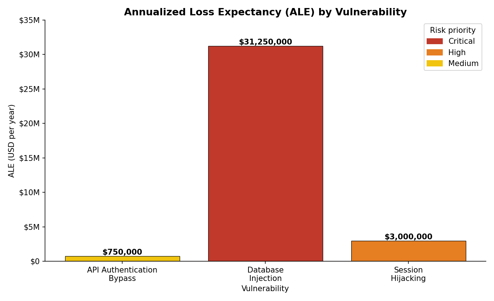
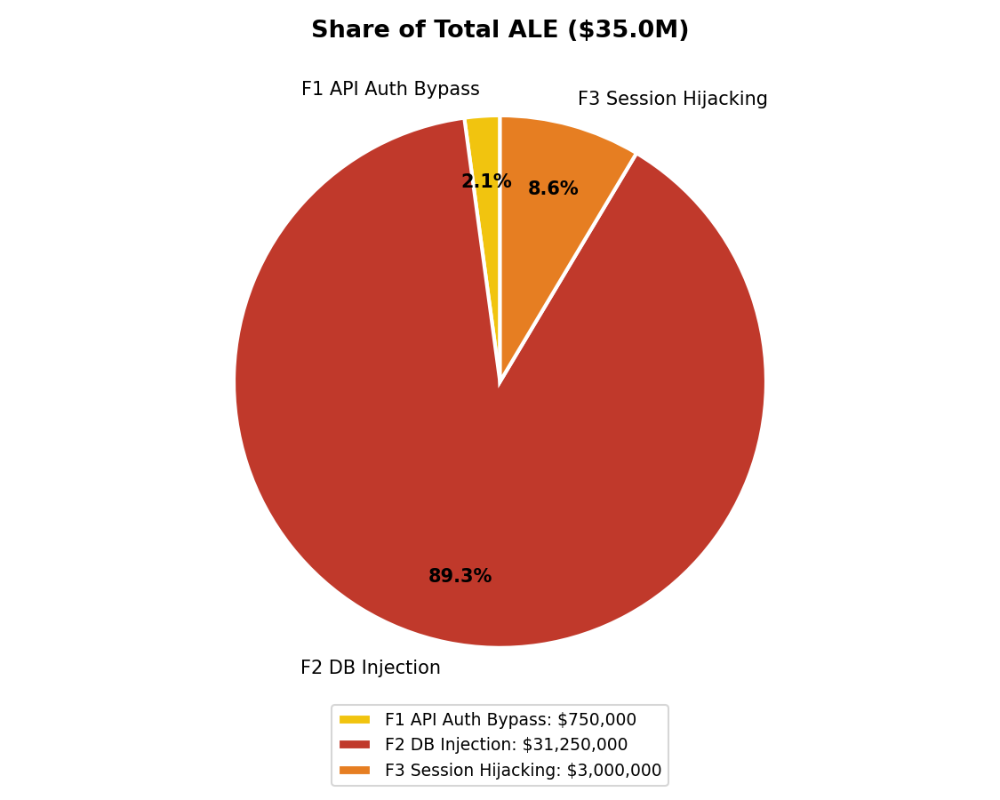
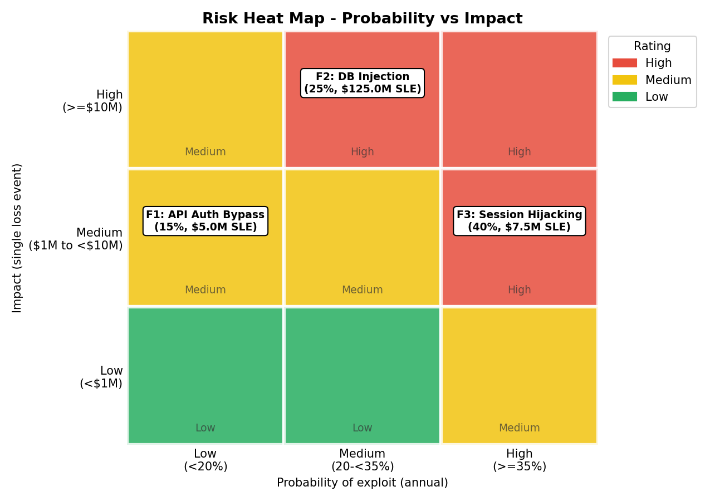

---

## 4. Phase 2 - Control evaluation

### Task 4: Cost-benefit analysis

Risk reduction per year = baseline ALE x effectiveness.

```
API Gateway : 750,000     x 90% =   $675,000   residual   $75,000
WAF         : 31,250,000  x 75% = $23,437,500   residual $7,812,500
MFA         : 3,000,000   x 95% =  $2,850,000   residual   $150,000
```

| Control | Initial | Annual maint. | Annual risk reduction | Year-1 cost | **Year-1 ROI** | **Payback** | 3-yr ROI |
|---|---|---|---|---|---|---|---|
| WAF | $150,000 | $25,000 | $23,437,500 | $175,000 | **13,293%** | **2.3 days** | 31,150% |
| MFA Enhancement | $200,000 | $30,000 | $2,850,000 | $230,000 | **1,139%** | **25.9 days** | 2,848% |
| API Security Gateway | $350,000 | $50,000 | $675,000 | $400,000 | **68.8%** | **204 days** (0.56 yr) | 305% |
| **Portfolio** | **$700,000** | **$105,000** | **$26,962,500** | **$805,000** | **3,249%** | **9.5 days** | 7,869% |

Worked example (WAF): Year-1 ROI = (23,437,500 - 175,000) / 175,000 = 132.93 = **13,293%**. Payback = 150,000 / (23,437,500 - 25,000) = 0.0064 yr = 2.3 days.

### Task 5: Control selection

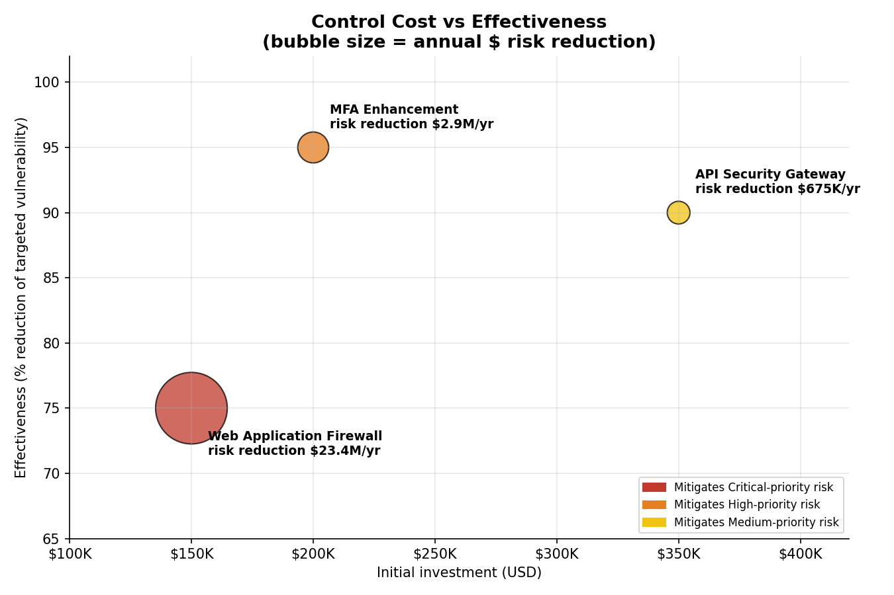
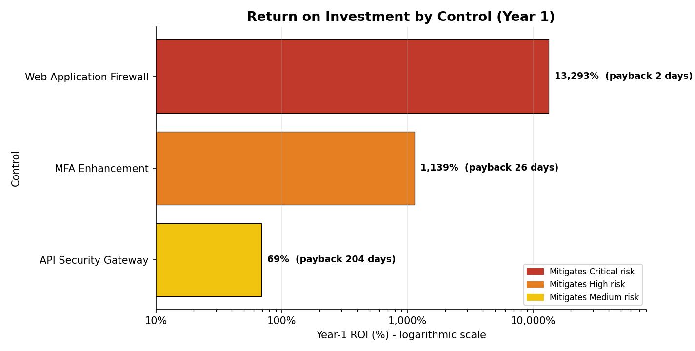
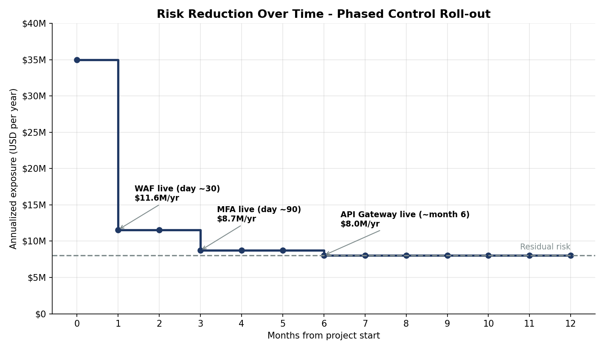
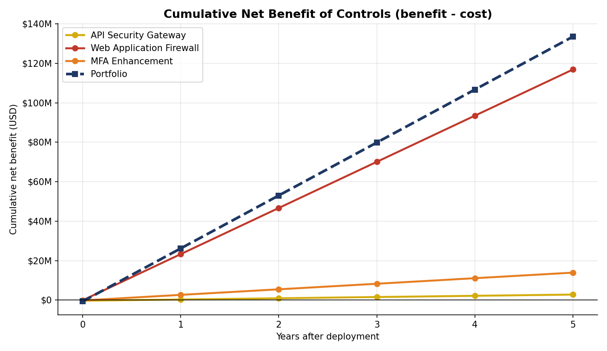

*The ROI chart uses a log scale because the three ROIs span almost three orders of magnitude.*

**Phased roll-out effect (Year 1):** with WAF live at month 1, MFA at month 3 and the API Gateway at month 6, annualised exposure drops 35.0M -> 11.6M -> 8.7M -> 8.0M, and expected loss avoided in year 1 is about **$23.96M** (WAF 21.48M + MFA 2.14M + API 0.34M), versus $26.96M at full steady state.

---

## 5. Phase 3 - Executive reporting

### Task 6: Executive dashboard

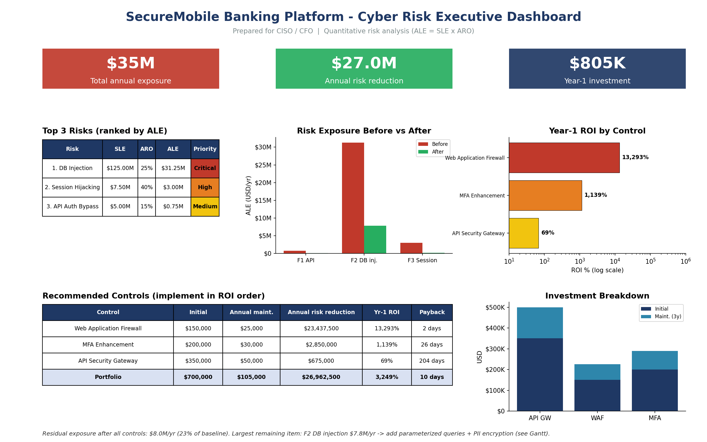

| Required visual | File |
|---|---|
| Exposure before/after (double bar) | `Images/07_before_after_double_bar.png` |
| Investment breakdown (stacked bar) | `Images/08_investment_stacked_bar.png` |
| ROI comparison (horizontal bar) | `Images/05_roi_horizontal_bar.png` |

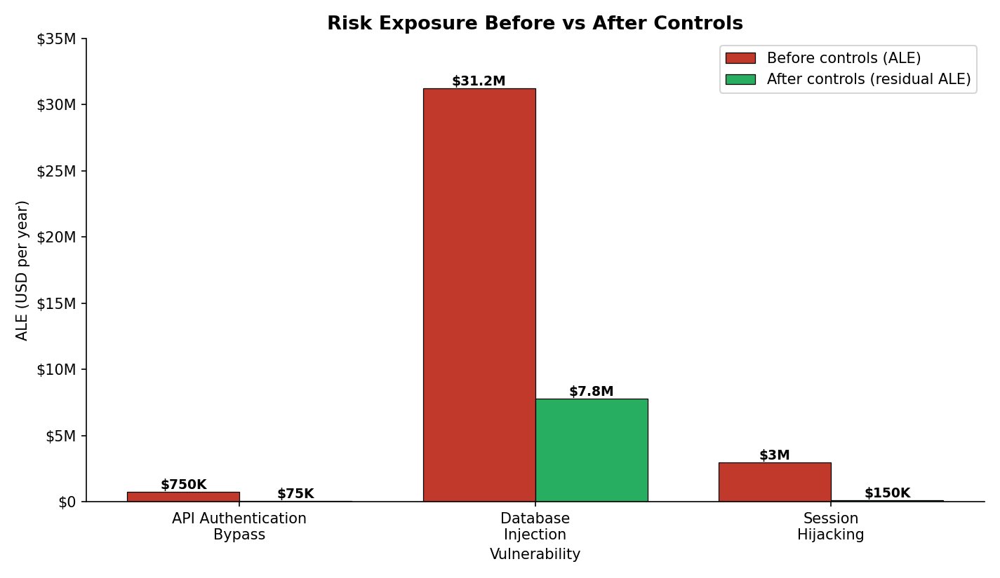
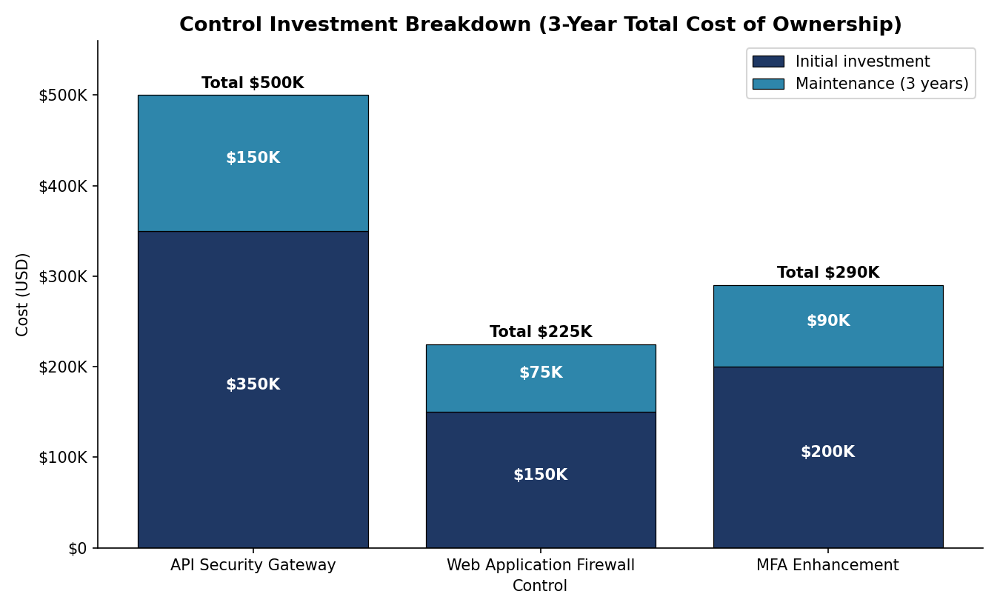

### Task 7: Risk treatment timeline

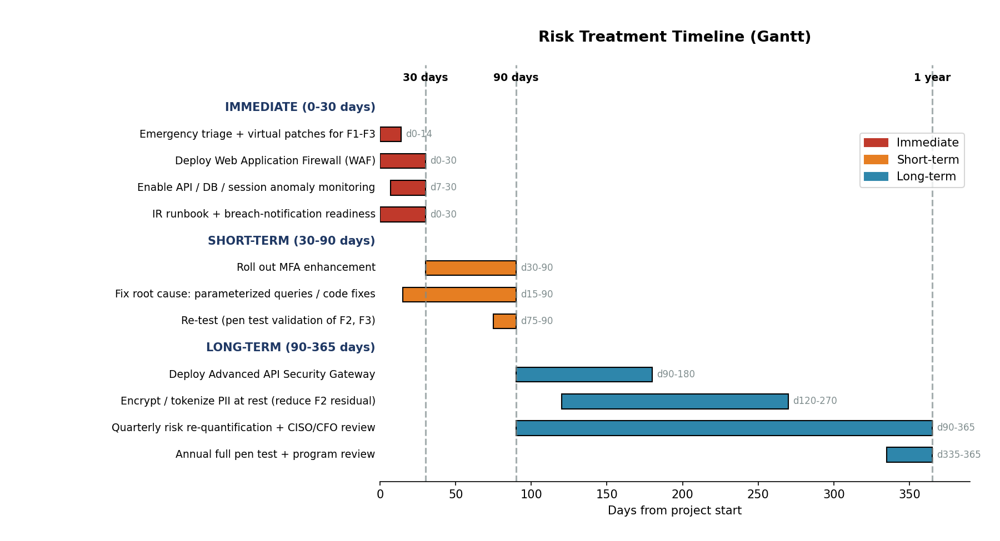

| Horizon | Actions | Rationale |
|---|---|---|
| **Immediate (0-30 days)** | Emergency triage and virtual patches; **deploy WAF**; monitoring on API/DB/sessions; IR runbook and breach-notification readiness | Highest ROI, 2-day payback, addresses 89% of exposure |
| **Short-term (30-90 days)** | **Roll out MFA**; fix injection root cause in code (parameterized queries); pen-test re-validation | Second-highest ROI; code fixes shrink the F2 residual |
| **Long-term (90-365 days)** | **Deploy API Security Gateway**; encrypt/tokenize PII at rest; quarterly risk re-quantification; annual pen test | Lowest ROI but still positive; reduces authentication-bypass tail risk |

### Executive briefing (text version)

- **Exposure:** $35.0M per year across three critical findings. Database injection alone is $31.25M (89%).
- **Recommendation:** fund all three controls: $700K one-off + $105K/yr. Sequence by ROI: WAF -> MFA -> API Gateway.
- **Return:** $26.96M/yr risk reduction (77%); portfolio Year-1 ROI 3,249%; portfolio payback about 10 days.
- **Residual risk:** $8.04M/yr, of which $7.81M is still database injection. The WAF alone (75%) is not enough; the Gantt adds code remediation and PII encryption to close that gap.
- **If the budget is capped,** see the bonus below.

---

## 6. Bonus - combined risk-control matrix

### Current vs residual exposure, and cost vs benefit

| Vulnerability | Control | Current ALE | Residual ALE | Risk reduction | Year-1 cost | Benefit / cost |
|---|---|---|---|---|---|---|
| F1 API Auth Bypass | API Gateway | $750,000 | $75,000 | $675,000 | $400,000 | 1.7x |
| F2 Database Injection | WAF | $31,250,000 | $7,812,500 | $23,437,500 | $175,000 | 133.9x |
| F3 Session Hijacking | MFA | $3,000,000 | $150,000 | $2,850,000 | $230,000 | 12.4x |
| **Total** | | **$35,000,000** | **$8,037,500** | **$26,962,500** | **$805,000** | **33.5x** |

### Optimal selection under a budget (Year-1 outlay)

| Combination | Year-1 outlay | Annual risk reduction | Year-1 net benefit |
|---|---|---|---|
| WAF | $175,000 | $23,437,500 | $23,262,500 |
| MFA | $230,000 | $2,850,000 | $2,620,000 |
| API Gateway | $400,000 | $675,000 | $275,000 |
| **WAF + MFA** | **$405,000** | **$26,287,500** | **$25,882,500** |
| API + WAF | $575,000 | $24,112,500 | $23,537,500 |
| API + MFA | $630,000 | $3,525,000 | $2,895,000 |
| **All three** | **$805,000** | **$26,962,500** | **$26,157,500** |

**Best choice by budget:**

| Budget (Year-1 outlay) | Optimal selection |
|---|---|
| under $175K | none affordable (accept risk / interim compensating controls) |
| $175K - $404K | **WAF only** |
| $405K - $804K | **WAF + MFA** (an API-Gateway-only or API+WAF mix is strictly worse) |
| $805K or more | **All three** |

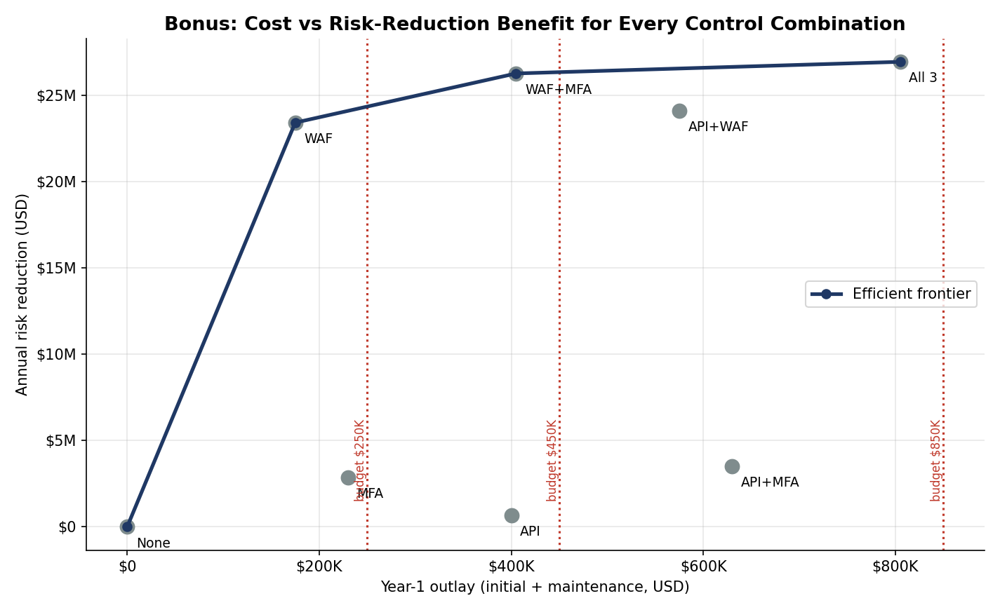

---

## 7. Limitations and sensitivity

- **ALE is an expected value, not a forecast.** A single F2 event costs $125M, roughly 155x the Year-1 cost of the whole control portfolio; the "expected" figure hides that tail.
- **F2 is the dominant, assumption-heavy number.** If only 10% of records were exposed, F2 ALE falls to $3.125M, but the WAF is still strongly positive (about 1,240% Year-1 ROI), so the recommendation is robust.
- **The API Gateway is the only marginal control** (69% Year-1 ROI). It is still positive and the ranking does not change, but it is the first candidate to defer if budget is cut. F1's SLE may be understated because an authentication bypass can enable other attacks.
- **Effectiveness percentages are vendor-style estimates** and are treated as certain. A sensitivity run (change `Inputs!D14:D16`) is a good next step.
- Controls are assumed independent, and annual probabilities are held constant over the horizon.

